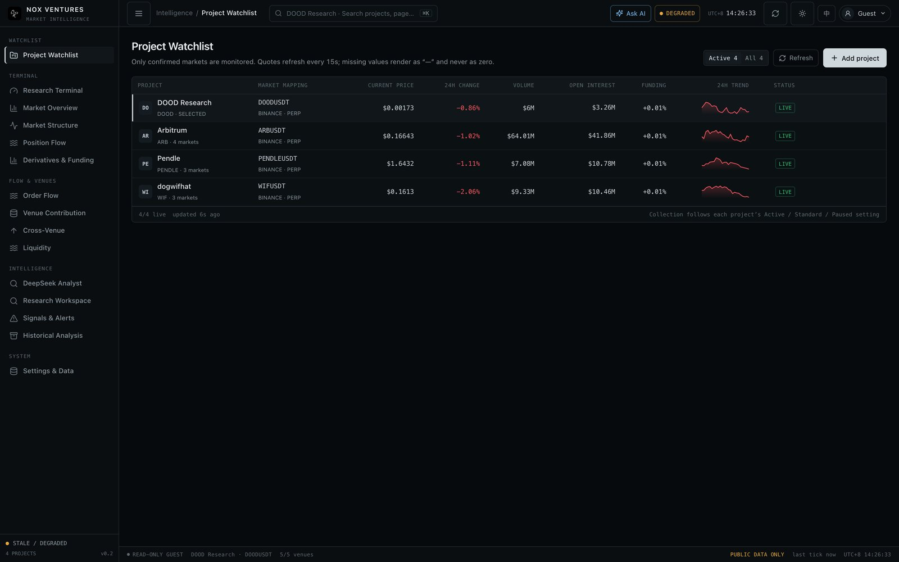

# NOX Market Intelligence Terminal

Latest (2026-11): [terminal shell redesign](docs/TERMINAL_UI_2026-11.md) and the
[DeepSeek research analyst](docs/DEEPSEEK_INTEGRATION.md). The watchlist is now a live price board,
the market strip is persistent across pages, and ⌘K / ⌘J drive navigation and AI from the keyboard.



New: [Upbit / Bithumb KRW spot discovery and quotes](KOREAN_SPOT.md), displayed separately from USDT derivatives.

Current authentication: [SQLite storage and sign-in dialog](AUTH_SQLITE.md). Anonymous read-only access and mutation roles are preserved.

New: [CoinGlass V4 and Binance Web3 holder analysis](COINGLASS_INTEGRATION.md). Configure the CoinGlass key in Settings / Data Sources; live acceptance awaits your key.

Binance exchange follow-up: [public Spot / USDT-M exchange panel and live checks](BINANCE_EXCHANGE_MARKET.md). Exchange data is independent of the authenticated Web3 provider below.

Latest data-source increment: [Binance Web3 market / DeFi read-only integration](BINANCE_WEB3_INTEGRATION.md). Server-side developer credentials and live acceptance are still required; no Binance Web3 mock values are presented as live data.

Latest analytics increment: [V2.5 frozen-event studies, signal readiness and separate weighted distributions](V2_5_EVENT_STUDY.md). This is descriptive research infrastructure, not a validated trading strategy. Prior rules: [V2.4 venue/aggregate regimes, adaptive baselines and flow attribution](V2_4_REGIMES.md).

Latest backend increment: [V2.3 historical queries, checkpoints and market mapping](V2_3_HISTORY.md). Apply migration 004 when configuring TimescaleDB. Real-database integration remains explicitly unverified without a test instance.

Current working-tree increment: [V2.2 implementation and deployment boundaries](V2_2_IMPLEMENTATION.md). It adds project-mode background collection, durable history, optional Timescale replication, mutation authentication and a first Signal Lab. The older phase notes below describe earlier implementation stages and are not the authoritative V2.2 status.

Independent, project-based crypto market monitoring for user-selected external tokens. This is not a broad BTC/ETH scanner, is separate from the NOX Active MM Dashboard, and contains no trade execution or private account connectivity.

## Working in this version

- Persistent Project Watchlist with no hardcoded default symbols. Projects can be discovered by token symbol or contract address, confirmed, reordered, archived, edited and removed.
- Native Spot and USDT perpetual discovery across Binance, Bitget, Bybit, OKX, Gate, KuCoin, MEXC and Aster, with explicit pair selection and one primary perpetual analytics feed per project. Aster uses its Binance-compatible USDⓈ-M REST API; it has no historical OI endpoint, so OI-dependent labels are withheld rather than estimated.
- Global project switching that updates the live market workspace without leaving the application.
- Live selected-project 24H price/volume, base and USD OI, funding and next-settlement countdown.
- Synchronized Price/Volume, base OI and futures CVD chart panels for a selected instrument.
- Hybrid chart mode on the Market Structure workspace: NOX native analytics remain the default, while a lazily loaded TradingView Advanced Chart adds drawing tools and built-in technical studies for the selected project.
- Automatic Binance symbol mapping for TradingView (`BINANCE:<symbol>.P` for perpetuals and `BINANCE:<symbol>` for spot), with project-scoped mode persistence and explicit unavailable states.
- Dedicated Position Flow Intelligence workspace with synchronized candlesticks, absolute OI, OI delta, taker buy/sell notional, volume delta and CVD panels.
- Robust OI-delta spike detection, evidence-backed probabilistic structure classifications, signal replay and a three-bar descriptive reliability check.
- 1M, 5M, 15M, 1H and 4H analysis. Binance's authoritative historical OI minimum is 5M, so 1M mode keeps OI at visible 5M timestamps rather than fabricating one-minute points.
- Live SSE bridge from Binance aggregate trades, mark price/funding and ticker streams, with stale/degraded states and automatic reconnect.
- Seven-venue REST snapshots plus public ticker/trade WebSocket adapters, normalized contract multipliers, capability disclosure and cross-exchange contribution analysis.
- DexPaprika contract-address identity lookup and a project-scoped on-chain liquidity workspace with token totals, top pools, DEX activity and explicit CEX/DEX interpretation boundaries.
- A versioned `nox.research-context.v1` JSON export that packages the project identity, CEX snapshots, on-chain context, evidence-backed inferences, nulls and methodology for downstream AI/MCP research workflows.
- Persistent project identity, selected markets, ordering and monitoring preferences in the local atomic data store.
- Explicit source, units, timestamps, coverage boundaries and missing-data states.
- Per-venue spot vs perpetual 24h turnover matrix (rolling as-of counters; USDT totals only, non-USDT quotes excluded without FX conversion) with a coverage gate and no cross-leg summation.
- Local volume-matrix records persisted as an explicit `volume` history kind, with per-venue spot/perp share deltas (descriptive only; Active 30s / Standard 5m sampling; no event-time alignment).
- Upbit/Bithumb KRW spot turnover is displayed in a separate KRW block with KRW-only shares; KRW is never converted to USD or added to USDT totals (no reliable timestamped FX source).
- Local event-time trade-tape volume bars (1m/5m/15m/1h/4h) per venue and market type, with explicit bucket completeness and gaps; USDT tape only, KRW stays in the KRW block.
- Event-time volume buckets carry both quote notional and normalized base quantity (per side), so a venue's tape can be checked against its own traded price.
- Volume rows expose perpetual turnover/OI and heuristic quality flags (stale/partial legs, turnover-vs-OI outlier vs covered-venue median, wide basis); flags point to legs for manual inspection and are not wash-trading proof.
- Event-time buckets also carry base-weighted VWAP, price high/low and the largest single print, so tape rows can be read as price-impact context rather than volume alone.
- Multi-timeframe alignment (1m/5m/15m/1h/4h) over synchronized OI windows: a directional claim requires ≥3 valid agreeing timeframes; conflicts or missing complete flow produce an explicit refusal instead of a vote.
- Alignment claims are persisted as a local `alignment` history kind and shown as a claim timeline (state counts, allowed/refused, last change); performance/outcome statistics are explicitly not claimed until a dedicated event study exists.
- Alignment outcome study (15m/60m/240m/1440m): only allowed claims, post-event entry, half-horizon minimum exit, configurable cost, placebo baseline, censored samples counted, and NO hit rate below 20 resolved samples.
- Local collection coverage panel: samples the journal per stream (snapshot/volume/alignment/trade), reports last-ingest age, ingest gaps and live/partial/stale/empty state so an empty interface is not mistaken for working collection.
- Venue coverage panel: from persisted volume records, shows per exchange whether spot/perpetual legs actually returned, their last quality and request failure counts; missing legs are explicit (spot-only/perp-only/missing).
- See `audit/FINAL_DELIVERY_INDEX.md` in the handoff workspace for the full incremental change/verification index (16+ batches, endpoints, evidence, remaining items).
- R17 review fixes (2026-10-29): direction-adjusted cost/hit math, point-in-time OI/flow baselines, decision-availableAt for outcomes, withheld-aware watchlist, read-only research GET, NAV/position-flow entry.
- Shared execution ledger (`shared/execution-ledger.ts`): fixed-base long/short P&L, fees, adverse slippage, settled funding cash, notional return vs margin ROI, equity curve and capital-capped allocation; golden fixtures are also consumed by the ORDER case Python backtest so formulas cannot diverge.
- Timeframe freshness is interval-aware: one closed candle period plus a 5m collection lag (future timestamps are refused), instead of a fixed 15m threshold that made normal 1h/4h windows look stale.
- Institutional terminal UI: grouped navigation, a persistent market strip (instrument, last, 24H, OI, funding countdown, mark, coverage, timeframe), a command palette (⌘K), a status bar with identity/coverage/last tick, tabular monospace numbers, and a UTC+8 clock.
- Live watchlist price board: every active project's primary feed is hydrated with price, 24H change, volume, OI, funding, a 24h sparkline and an explicit coverage state (`GET /api/watchlist/quotes`, 12s TTL). Missing values stay `null` and render as `—`.
- CCXT market-data layer: `htx` / `bingx` / `phemex` / `bitfinex` USDT perpetuals plus a labelled fallback when a native REST adapter fails, and spot snapshots where no native adapter exists. CCXT rows stay `partial` (no aggressor flow) and are flagged in the volume matrix. See [CCXT_INTEGRATION.md](docs/CCXT_INTEGRATION.md).
- DeepSeek research analyst: read-only, evidence-grounded, streaming chat plus a structured brief (observed / inferred / hypotheses with invalidation / risks / missing data), citation ids validated against the evidence packet, server-key mode for signed-in users and browser-local key mode for everyone else. See [DEEPSEEK_INTEGRATION.md](docs/DEEPSEEK_INTEGRATION.md).
- UI hardening: locale-aware relative timestamps (no English leakage in zh), heartbeat events keep an idle-but-open stream from flipping to STALE, and cross-venue cards show coverage unavailable instead of fabricated 0/0 values.

## Verification

```bash
npm run typecheck   # tsc -b
npm run lint
npm test            # node:test unit suites
npm run build
npm run e2e -- --base=http://127.0.0.1:4173   # needs the app + API running; Chrome auto-detected
```

`npm run e2e` drives the real UI (shell, every page, ⌘K palette, ⌘J AI drawer) and fails on
any React error or 5xx response. CI runs it against the production build served by the API.

## Run locally

Requires Node.js 22.13+.

```bash
npm install
cp .env.example .env   # optional; the API loads .env automatically (real env vars win)
npm run dev
```

Open `http://127.0.0.1:4173`. The API listens on `127.0.0.1:8787` and Vite proxies `/api` during development.

```bash
npm test
npm run typecheck
npm run build
```

Optional Phase 1 production storage services:

```bash
docker compose up -d
```

## Data sources and limitations

No API key is required. Market discovery uses public metadata from all seven centralized exchanges. Contract-address identity resolution prefers DexPaprika cross-chain search with a DexScreener fallback and always requires user confirmation. DexPaprika's public tier may be delayed and rate-limited; its pool totals cover only the returned rows. DEX liquidity is never presented as centralized-exchange order-book depth.

High-frequency native chart history currently uses the selected project's Binance perpetual feed. The other venues provide normalized REST snapshots and live ticker/trade streams where the exchange supports them. CVD and Volume Delta use the latest 1,000 Binance aggregate-trade records returned by the venue, so busy instruments can have much shorter flow coverage than the selected candle window. Aggregate trades can combine fills according to venue rules. Historical OI retention is venue-limited and its minimum Binance API interval is 5M.

The optional TradingView mode uses the public TradingView widget through `react-ts-tradingview-widgets`. It is a third-party iframe with its own data connection and required TradingView attribution. NOX cannot inject its Binance feed, private indicators or Pine scripts into that widget, and its crosshair cannot be synchronized with the native OI/CVD panels. Switching back to NOX mode removes the iframe and leaves the existing project data subscription unchanged.

Position-flow classifications combine price direction, base-unit OI change and available aggressor flow. Names such as “Potential Long Build-up” are hypotheses, not direct observations of who opened or closed a position. The in-window backtest is descriptive: it excludes fees, slippage and regime changes, and low sample counts are labeled explicitly.

The application never claims to identify counterparties, “organic” liquidity, manipulation, or who opened/closed a position. Public feeds cannot establish those facts.

## Development sequence remaining

1. Wire the included TimescaleDB/Redis services into project-scoped background ingestion, retention, backfill and gap recovery.
2. Add durable computed 1m/5m/15m/1h/4h/1d volume/CVD bars and locally sampled 1m OI beyond the exchange REST window.
3. Evaluate persisted alert rules and add notification delivery/history.
4. Implement sequence-correct L2 depth snapshots/deltas, spread/depth metrics and impact simulation.
5. Add liquidation-event coverage, spot CVD, time-aligned multi-venue CVD and calibrated regime models with out-of-sample validation.
6. Persist research-context snapshots and predictions, then evaluate expired signals against subsequent market data by setup type.
7. Add authentication and production deployment configuration.

See [ARCHITECTURE.md](./ARCHITECTURE.md) for the audit, boundaries and data semantics.
