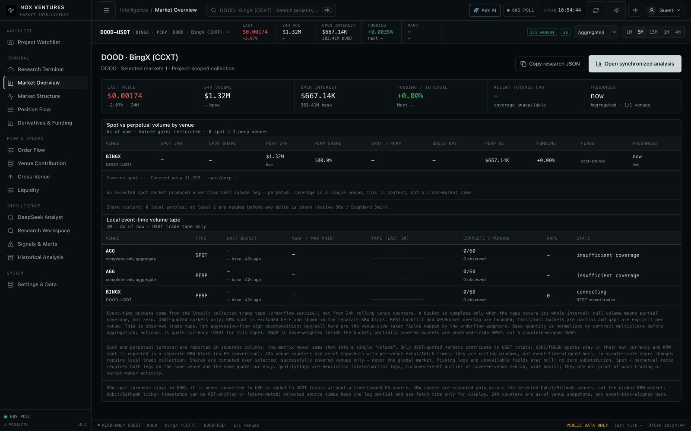
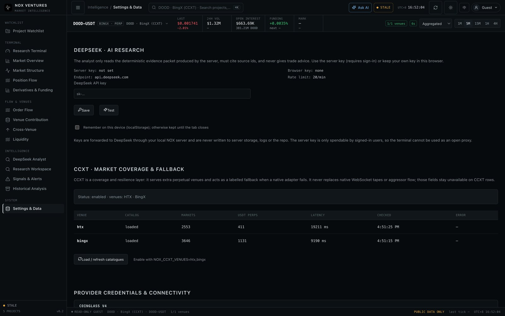

# CCXT 行情接入 / CCXT market-data layer

CCXT（https://github.com/ccxt/ccxt）在这里是**覆盖与韧性层**，不是主路径替代品。
The native adapters remain the primary path for the seven exchanges they cover; CCXT adds venues and a
labelled fallback. Nothing about the data-semantics rules in the terminal changes.

## 1. 它做什么 / What it does

| 能力 | 原生适配器 | CCXT |
| --- | --- | --- |
| 7 家原生交易所 REST 快照 | ✅ 首选 | 仅当原生失败时回退（标记 `fallback`） |
| 现货快照（原生没有实现） | ❌ | ✅ `NOX_CCXT_SPOT` |
| 额外 USDT 永续交易所 | ❌ | ✅ `htx` / `bingx` / `phemex` / `bitfinex` |
| WebSocket 成交 / CVD / 主动买卖量 | ✅ | ❌ 保持 unavailable |
| 逐笔成交带（订单流页面） | ✅ | ❌ 明确失败，不伪造 |
| 合约乘数 / OI 单位归一化 | 手工核对 | CCXT `contractSize`，USD 值优先 |

```text
project market ──► marketSnapshot()
                     ├─ upbit/bithumb ──► KRW panel only (never USDT)
                     ├─ CCXT-only venue ──► ccxtSnapshot()
                     ├─ spot market ──────► ccxtSnapshot() (native has no spot snapshot)
                     └─ native venue ─────► nativeSnapshot()
                                             └─ failure + NOX_CCXT_FALLBACK ──► ccxtSnapshot()
```


*BingX 永续报价：成交量矩阵中的 `ccxt-source` 标记说明该行来自 CCXT 适配器。*

## 2. 启用 / Enabling

```bash
# .env
NOX_CCXT_ENABLED=true
NOX_CCXT_VENUES=htx,bingx      # 额外交易所；留空则行为与之前完全一致
NOX_CCXT_FALLBACK=true         # 原生失败的带标记回退
NOX_CCXT_SPOT=true             # 现货快照（原生未覆盖）
```

- 依赖已加入 `package.json`（`ccxt`），但通过动态 `import()` 加载：未启用时不影响启动与构建。
- 首次发现会加载交易所目录（HTX ~2.5k markets / 22s，BingX ~3.6k / 11s）。服务启动时已在后台预热，
  之后 30 分钟复用缓存（`NOX_CCXT_MARKETS_TTL_MS`）。
- 新增的 4 家交易所在启用前不会出现在发现结果或交易所选择器中（`/api/exchanges` 返回 `enabled:false`）。

## 3. 语义边界 / Semantics

1. **只接入公开行情**：不配置 API key，不读取账户、仓位或私有接口。
2. **CCXT 行永远是 `partial`**：没有逐笔主动买卖量就没有 CVD；这些字段在 `unavailable` 中列出，绝不补 0。
3. **OI 单位**：优先使用交易所上报的 USD 名义值；只有金额时才用 `contractSize` 还原基础币数量，
   并在 `source` 中注明 `(OI base derived from USD value)`。
4. **成交量**：优先 `quoteVolume`；只有基础币成交量时按最后价推导，并在 `source` 中注明
   `(volume derived from base × last)`。
5. **回退可见**：原生失败后回退的快照 `source` 会追加 `· fallback (native: …)`，成交量矩阵额外加
   `ccxt-source` 质量标记。
6. **USDT 限定**：只暴露 `quote === 'USDT'` 的永续合约；USD/KRW 报价不会进入 USDT 聚合
   （`krakenfutures` 因只有 USD 合约而未纳入）。
7. **无 WebSocket**：CCXT 交易所的订单流/逐笔带会明确报错，而不是显示空图。

## 4. 运维 / Operations

- `GET /api/ccxt/health`：只读缓存状态；`?probe=1` 会真实加载目录（设置页「加载 / 刷新交易目录」）。
- `GET /api/exchanges`：返回全部场所，新增 `transport: 'native' | 'ccxt'` 与 `enabled`。
- 顶部状态：`LIVE`（WebSocket）/`60S POLL`（仅轮询）/`STALE`/`DEGRADED`，CCXT 场所默认显示轮询。
- 错误不会静默：目录加载失败会写入健康面板的 `error` 列，并在发现结果里生成 warning。


*设置页：启用场所、目录加载状态、市场数、延迟与错误。*

## 5. 已知限制 / Limits

- CCXT `fetchTicker` 的 `markPrice` 并非所有交易所都返回（例如 BingX 当前为 `null`）。
- `loadMarkets()` 无法按符号过滤，冷缓存较慢；已用 TTL + 启动预热缓解。
- 没有 CCXT 的历史 K 线接入：非 Binance 交易所的原生同步图表仍不可用（下一步可接 `fetchOHLCV`）。
- 启用更多交易所会线性增加发现耗时与内存；建议只开实际需要的场所。
